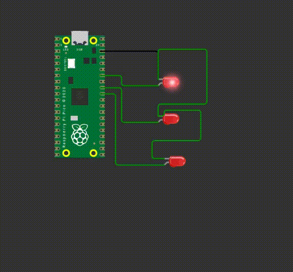

# VecOs

> Lightweight preemptive RTOS micro-kernel, written in ARM Cortex-M0+ Assembly and Modern C++17.

[](https://github.com/Ferdinaelectro1/VecOs/actions/workflows/firmware.yml)
[](LICENSE)
[](https://www.raspberrypi.com/products/rp2040/)
[]()

---

## What is VecOs?

VecOs is a from-scratch RTOS micro-kernel targeting the **Raspberry Pi Pico (RP2040)**. It combines bare-metal ARM Cortex-M0+ assembly for context switching with a clean C++17 API to make preemptive multitasking accessible without sacrificing reliability or memory safety.

**Core design goals:**
- Zero heap usage — all stacks are statically allocated at compile time via C++ templates
- Minimal API surface — three calls to get tasks running
- No external dependencies beyond the Pico SDK

---

## Features

- **Preemptive multitasking** — context switches are driven by a 1 ms hardware timer tick and the `PendSV` exception, not cooperative yields
- **Priority-aware scheduling** — the scheduler now picks the highest-priority READY task, while still waking sleeping tasks when their timer expires
- **Type-safe static stack allocation** — `vecos::Task<StackSize>` allocates each task's stack at compile time, guaranteeing zero heap fragmentation and no runtime allocation failures
- **Clean C++ API** — hides raw register manipulation behind a straightforward object-oriented interface
- **Synchronization primitives** — lightweight `vecos::Mutex` and `vecos::Semaphore` for mutual exclusion and resource counting
- **Message queues** — `vecos::Queue<T, N>` for passing typed messages between tasks with blocking send/receive
- **Task sleep API** — `vecos::sleep_task(ms)` or `sleep_task(std::chrono::milliseconds)` to suspend the calling task for a duration
- **Immediate wake-ups** — unblocking a task from `Mutex::unlock()`, `Semaphore::signal()` or a `Queue` triggers a context switch right away, so a higher-priority task does not wait for the next tick (about 4 us measured on the semaphore wake-up example, against about 1000 us without)
- **Stack overflow detection** — a canary word at the bottom of every task stack is checked at each context switch; a user handler can be registered with `os.set_stackOverflowHandler(...)`, and the default handler freezes the system
- **Port-provided clock** — the kernel reads time through `vecos::port::get_time_us()`, implemented by each port, and uses it for timed sleep/wake
- **Tested on the PC** — the scheduler logic is unit-tested with Google Test against a fake port, and CI builds the firmware and runs the tests on every push

## Recent Updates

- **Immediate wake-ups**: `yield_cpu()` now requests PendSV directly (no `svc`), so it is safe to call with interrupts disabled, and `Mutex::unlock()`, `Semaphore::signal()` and `Queue` call it when they unblock a task.
- **Stack overflow detection**: canary check in the scheduler, configurable handler.
- **Port-provided clock**: `platform_timer.h` was removed, the clock is now `vecos::port::get_time_us()`.
- **Unit tests and CI**: Google Test suite for the scheduler running on the PC, plus a GitHub Actions workflow that builds the firmware and runs the tests.
- **Priority scheduling**: `vecos::TaskPriority`, highest-priority READY task first, with round-robin among tasks of the same priority.

---

## Project Structure

```
VecOs/
├── CMakeLists.txt
├── README.md
├── include/
│   └── vecos/                    # Public headers
│       ├── scheduler.h           # TaskBase, Task<N>, and Scheduler declarations
│       ├── mutex.h, semaphore.h, queue_message.h
│       ├── tcb.hpp               # Task control block (layout shared with the ASM)
│       └── port.h                # Contract that every port must implement (including the clock)
├── src/
│   ├── vecos/                    # Portable core: scheduler, mutex, semaphore
│   └── ports/
│       └── rp2040/               # RP2040 port
│           ├── port.cpp          # Tick timer, PendSV setup, yield, interrupts
│           ├── init.S            # Starts the first task
│           └── context_switch.S  # ASM context save/restore, PendSV handler
├── tests/
│   ├── CMakeLists.txt            # Host-side tests (Google Test)
│   ├── scheduler_test.cpp        # Scheduler logic and TCB layout tests
│   └── fake/
│       └── fake_port.cpp         # Fake port used to run the kernel on the PC
└── examples/
    ├── blink/                    # Two preemptive blinking tasks
    ├── priority_task/            # Three LED tasks plus one CRITICAL button task
    ├── semaphore_latency/        # Semaphore wake-up latency, measured in us
    ├── stack_overflow_example/   # Canary overwrite and overflow handler
    ├── mutex_and_print/          # Mutex-protected output
    ├── producer_consumer/        # Producers and consumers with a semaphore
    ├── message_exchanger/        # Sender and receiver with a queue
    └── CoreRacer_game/           # OLED game demo (SSD1306)
```

---

## Quick Start

### Prerequisites

Install the GNU ARM Embedded Toolchain:

```bash
sudo apt update
sudo apt install cmake gcc-arm-none-eabi build-essential libnewlib-arm-none-eabi
```

Set your Pico SDK path:

```bash
export PICO_SDK_PATH=/opt/pico-sdk   # adjust to your local installation
```

> CMake will automatically fetch and build `picotool` locally if it is not found on your system — no manual installation required.

### Build

```bash
git clone https://github.com/Ferdinaelectro1/VecOs.git
cd VecOs
mkdir build && cd build
cmake ..
make -j$(nproc)
```

### Run the tests on your PC

The scheduler logic runs on your computer, against a fake port, so no Pico SDK is needed. You only need CMake, a host C++ compiler (`g++`) and an internet connection (CMake downloads Google Test the first time):

```bash
cmake -S tests -B build-tests
cmake --build build-tests
ctest --test-dir build-tests --output-on-failure
```

The same tests run in CI on every push.

### Flash

Boot your Pico in **BOOTSEL** mode, then drag and drop the generated UF2 for the example you built, for example `build/examples/priority_task/priority_task.uf2`, onto the mounted volume.

---

## Usage

```cpp
#include <pico/stdlib.h>
#include <vecos/scheduler.h>

#define LED_PIN 28

void BlinkTask(void* arg) {
    (void)arg;
    gpio_init(LED_PIN);
    gpio_set_dir(LED_PIN, GPIO_OUT);

    while (true) {
        gpio_put(LED_PIN, 1);
        vecos::sleep_task(500);
        gpio_put(LED_PIN, 0);
        vecos::sleep_task(500);
    }
}

// Statically allocate a 4KB stack for this task — no heap involved
vecos::Task<1024> task1(BlinkTask);

vecos::Scheduler os;

int main() {
    os.add_task(task1);
    os.start();         // never returns
}
```

The `Task<N>` template parameter is the stack size in 32-bit words. `Task<1024>` allocates 4KB.

Additional APIs

Priority example:

```cpp
// Priorities: LOW, NORMAL (default), HIGH, CRITICAL
vecos::Task<1024> worker(WorkerTask);                          // NORMAL
vecos::Task<512>  alarm(AlarmTask, TaskPriority::CRITICAL);    // runs first whenever READY

// Or change it later
worker.setPriority(TaskPriority::HIGH);
```

Tasks of the same priority share the CPU in round-robin. A higher-priority task that is READY always runs before lower-priority ones, so give your `CRITICAL` tasks a `sleep_task()` or a blocking call to let the others run.

Mutex example:

```cpp
vecos::Mutex m;

void ProtectedTask(void*) {
    m.lock();
    // critical section
    m.unlock();
}
```

Semaphore example:

```cpp
vecos::Semaphore sem(1);

void Worker(void*) {
    sem.wait();
    // access resource
    sem.signal();
}
```

Queue example (producer/consumer):

```cpp
vecos::Queue<int, 8> q;

void Producer(void*) {
    for (int i=0;i<100;i++) q.send(i);
}

void Consumer(void*) {
    int v;
    while(true){ q.receive(v); /* use v */ }
}
```

Sleep example:

```cpp
// suspend current task for 100 ms
vecos::sleep_task(100);
```

---

## How It Works

```
Timer tick (every 1 ms)  or  yield_cpu() (sleep, blocking call, wake-up)
        │
        ▼
PendSV pended directly (write to the ICSR register)
        │
        ▼
PendSV runs (lowest priority — executes after all hardware IRQs clear)
        │
        ├─ ASM saves R4–R11 onto the current task's PSP
        │
        ├─ C++ vTaskSwitchContext() wakes expired sleepers, then selects the
        │  highest-priority READY task (round-robin among equals; idle if none)
        │
        └─ ASM restores R4–R11 from the new task's stack, updates PSP, returns
```

The hardware automatically saves and restores R0–R3, R12, LR, PC, and xPSR on every exception entry and exit — VecOs only handles the software-callee-saved registers (R4–R11) manually.

---

## Integrating VecOs into Your Project

Add VecOs as a subdirectory and link against the `vecos` target:

```cmake
add_subdirectory(libs/VecOs)

target_link_libraries(your_project
    pico_stdlib
    vecos
)
```

Your `#include` paths are configured automatically — no manual `include_directories` needed.

---

## API Reference

| Symbol | Description |
|---|---|
| `vecos::Task<N>` | Declares a task with a statically allocated stack of N words (N × 4 bytes); optional `TaskPriority` constructor argument |
| `vecos::Scheduler` | The kernel object. One instance per application |
| `os.add_task(task)` | Registers a task. Returns `false` if the internal limit is reached |
| `os.start()` | Starts the scheduler. Never returns |
| `os.task_count()` | Returns the number of registered tasks |
| `vecos::TaskPriority` | Enum: `LOW`, `NORMAL` (default), `HIGH`, `CRITICAL` |
| `task.setPriority(p)` | Changes the priority of a task |
| `vecos::Mutex` | Mutex object with `lock()`, `unlock()`, and `try_lock()` |
| `vecos::Semaphore` | Counting semaphore with `wait()` and `signal()` |
| `vecos::Queue<T,N>` | Fixed-size typed message queue with `send()` and `receive()` blocking operations |
| `vecos::sleep_task(...)` | Suspend calling task for a duration (ms or chrono) |
| `os.set_stackOverflowHandler(fn)` | Registers `void fn(TCB *)`, called when a task's stack canary has been overwritten. Without one, the default handler disables interrupts and never returns. A handler that returns lets the scheduler keep running with a corrupted stack |
| `vecos::port::get_time_us()` | Microsecond clock, implemented by each port (RP2040 uses `time_us_64()`) |
| `HARD_MAX_TASK` | Compile-time limit of tasks (default 16) |

---



## License

MIT — free to use, fork, and build on top of.